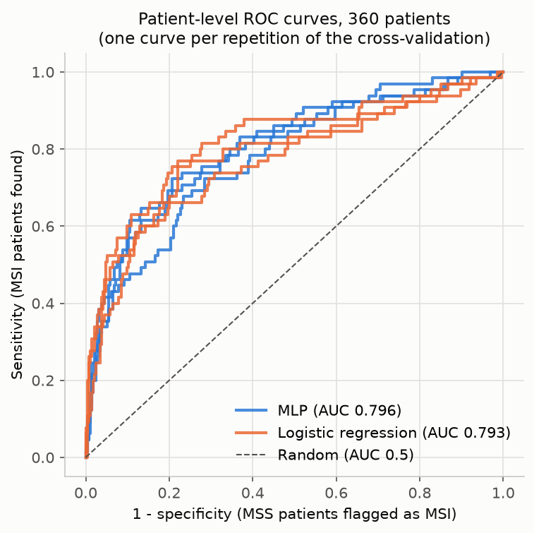
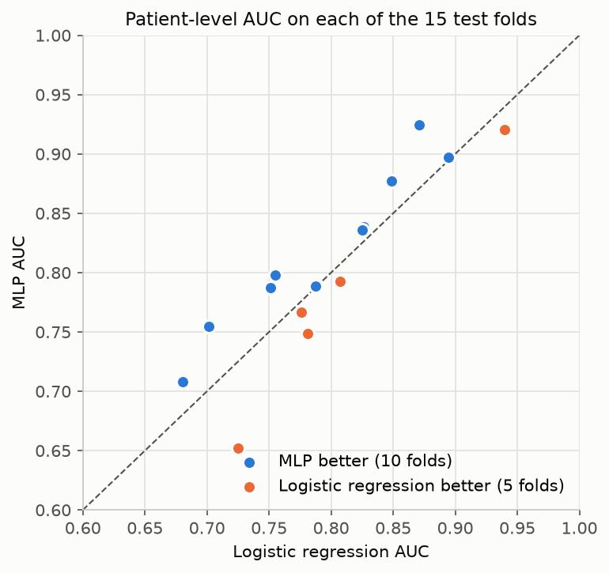
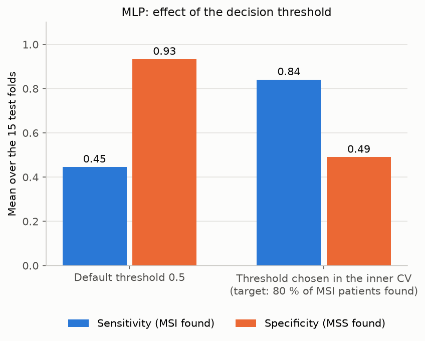

# Predicting Microsatellite Instability from Colorectal Cancer Histology with an MLP

An MLP trained on histology tiles of colorectal cancer patients from TCGA to predict
whether a tumour is **MSI** (microsatellite instable) or **MSS** (microsatellite stable),
evaluated **patient by patient** with nested cross-validation.

## Why it matters

MSI tumours respond exceptionally well to **immunotherapy**, but MSI status requires an
additional genetic or immunohistochemical test that is not done for every patient.
The H&E histology slide, on the other hand, is available for every patient. Predicting
MSI from that slide could help select the patients who should be tested first.

## Data

[Kather (2019), *Histological images for MSI vs. MSS classification in gastrointestinal
cancer*](https://doi.org/10.5281/zenodo.2530835), colorectal part (TCGA, FFPE diagnostic
slides), used through its [Kaggle version](https://www.kaggle.com/datasets/joangibert/tcga_coad_msi_mss_jpg).

| | |
|---|---|
| Tiles | **192,312** tiles of 224 × 224 px (tumour detected, colour-normalised by Kather) |
| Patients | **360**: 65 MSI, 295 MSS |
| Tiles per patient | 6 to 4,305 (median 293) |
| Label | patient level, inherited by all the tiles of the patient |

Every file name contains the TCGA patient barcode (for example `TCGA-CM-4746`), which
makes a strict **patient-level** split possible. The images are not included in this
repository (5.8 GB).

## Method

```
tile (224 × 224)
  → ResNet18 pre-trained on ImageNet, frozen: 512 features per tile   (extract_features.py)
  → MLP trained on the tiles: probability that the tile is MSI        (train_mlp.py)
  → mean of the probabilities of all the tiles of the patient
  → patient diagnosis: MSI if the mean is above the decision threshold
```

- **Only the MLP is trained.** The ResNet18 is frozen and only turns each tile into 512
  numbers, computed once.
- **Training tiles**: at most 100 tiles per patient, so that a patient with thousands of
  tiles does not dominate training. The MSI class is weighted in the loss
  (`BCEWithLogitsLoss` with `pos_weight`), Adam, 15 epochs.
- **Evaluation**: repeated stratified cross-validation on the **patients** (5 folds ×
  3 repetitions = 15 test folds). The tiles of a test patient are never seen in training.
- **Nested cross-validation**: inside each training fold, a 3-fold inner cross-validation
  on the training patients chooses
  1. the architecture among 3 candidates (best patient-level AUC),
  2. the decision threshold: the highest threshold that still finds at least 80 % of the
     MSI patients. Missing an MSI patient is worse than an extra genetic test for an MSS one.

  The test patients are never used to choose anything.
- **Baselines** on the same folds and the same features: logistic regression (its threshold
  is chosen the same way) and majority class.

## Results

Patient-level results, mean ± standard deviation over the 15 test folds (threshold chosen
in the inner cross-validation):

| Model | AUC | Sensitivity (MSI found) | Specificity (MSS found) | Balanced accuracy | F1 |
|---|---|---|---|---|---|
| **MLP** | **0.806 ± 0.078** | **0.841** | 0.490 | 0.666 | 0.409 |
| Logistic regression | 0.798 ± 0.072 | 0.815 | 0.548 | 0.682 | 0.425 |
| Majority class | 0.500 | 0.000 | 1.000 | 0.500 | 0.000 |

For reference, Kather et al. (2019) report a patient-level AUC of **0.77** (95 % CI
0.62 to 0.87) on a single train / test split of the same TCGA colorectal cohort, with a
fine-tuned deep residual network (ResNet). The evaluation protocols differ, so this comparison is only
indicative.

- **MLP against logistic regression**: the MLP is better in 10 of the 15 folds
  (+0.008 AUC on average), but the difference is **not statistically significant**
  (paired Wilcoxon test, p = 0.28). The two models should be considered equivalent.
- **Architecture**: the inner cross-validation chose *2 layers 512-128, dropout 0.5,
  batchnorm* in 9 folds, *1 layer 512, dropout 0.5* in 3 and *2 layers 256-64,
  dropout 0.3* in 3.
- **Decision threshold**: with the default threshold 0.5, the MLP found only 45 % of
  the MSI patients. The threshold chosen in the inner cross-validation (0.29 on average)
  raises this to 84 %, at the cost of more MSS patients flagged for testing.

| ROC curves | MLP vs logistic regression | Decision threshold |
|---|---|---|
|  |  |  |

The AUC in the ROC legend is computed on the 360 patients of each repetition at once
(pooled), which explains the small difference with the mean over the folds.

### Architecture exploration

`explore_architectures.py` compares 10 MLP variants on the 15 folds of a first
cross-validation (`random_state=42`):

| Variant | Mean AUC |
|---|---|
| 2 layers 512-128, dropout 0.5, batchnorm | 0.814 |
| 1 layer 512, dropout 0.5 | 0.813 |
| 1 layer 256, dropout 0.2, ensemble of 5 seeds | 0.813 |
| 2 layers 256-64, dropout 0.3 | 0.812 |
| *Logistic regression* | *0.810* |
| 1 layer 256, dropout 0.5, weight decay 1e-2 | 0.806 |
| 1 layer 256, dropout 0.2 | 0.805 |
| 1 layer 256, dropout 0.5, input dropout 0.2 | 0.804 |
| 3 layers 512-256-64, dropout 0.5 | 0.803 |
| 2 layers 256-64, dropout 0.3, 300 tiles per patient | 0.799 |
| 1 layer 256, dropout 0.2, 300 tiles per patient | 0.798 |

All the variants reach about 0.80 to 0.81. The 3 best architectures were then put into
the nested cross-validation above, run on **new folds** (`random_state=2026`), so that the
selection made here does not bias the final results.

## Limitations

- **Small number of MSI patients**: 65 in total, about 13 per test fold, hence the large
  variation between folds (AUC from 0.65 to 0.92).
- **No external validation**: all patients come from TCGA. Performance on slides from
  another hospital is unknown.
- **Frozen ImageNet features**: all the classifiers reach the same ceiling, which suggests
  that the features, not the classifier, are the limiting factor. Features from a model
  pre-trained on histology (and not on TCGA, to avoid leakage) or fine-tuning the CNN
  would be the next step.
- **Low specificity at high sensitivity**: to find 84 % of the MSI patients, about half
  of the MSS patients are also flagged. The model could reduce the number of genetic
  tests, not replace them.
- **Label definition**: the positive class of the dataset (`MSIMUT`) groups
  microsatellite-instable and highly mutated tumours, as defined by Kather (2019).
- **Simple aggregation**: the patient probability is the mean of its tiles. Attention-based
  aggregation could weigh the most informative regions.

## Running

```bash
pip install -r requirements.txt
```

1. Download the [Kaggle dataset](https://www.kaggle.com/datasets/joangibert/tcga_coad_msi_mss_jpg)
   and extract the folders `MSIMUT_JPEG/` and `MSS_JPEG/` into `data/`.
2. Run the scripts:

```bash
python extract_features.py        # 512 features per tile -> features.npy, tiles.csv (about 1 h on CPU)
python train_mlp.py               # nested cross-validation (about 20 min on CPU)
python explore_architectures.py   # architecture exploration (about 40 min on CPU)
python plots.py                   # figures and Wilcoxon test
```

## Files

| File | Content |
|---|---|
| `extract_features.py` | Frozen ResNet18: 512 features per tile |
| `train_mlp.py` | MLP, nested cross-validation, baselines, patient-level metrics |
| `explore_architectures.py` | Comparison of 10 MLP variants |
| `plots.py` | Figures and paired Wilcoxon test |
| `results_folds.csv` | Metrics of each test fold |
| `results_summary.csv` | Means and standard deviations |
| `chosen_settings.csv` | Architecture and thresholds chosen in each fold |
| `patient_predictions.csv` | Out-of-fold probability of each patient |
| `architectures_folds.csv`, `architectures_summary.csv` | Architecture exploration results |
| `figures/` | Figures |

## Credits

- Data: Kather, J. N. (2019). *Histological images for MSI vs. MSS classification in
  gastrointestinal cancer, FFPE samples*. Zenodo. https://doi.org/10.5281/zenodo.2530835
  (CC BY 4.0), from TCGA slides (https://portal.gdc.cancer.gov).
- Reference study: Kather, J. N. et al. (2019). Deep learning can predict microsatellite
  instability directly from histology in gastrointestinal cancer. *Nature Medicine*, 25,
  1054-1056. https://doi.org/10.1038/s41591-019-0462-y
